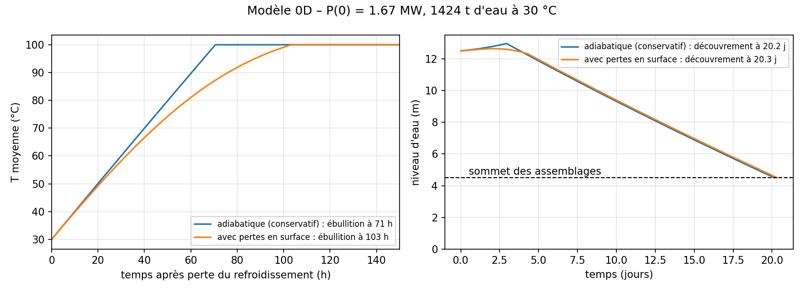
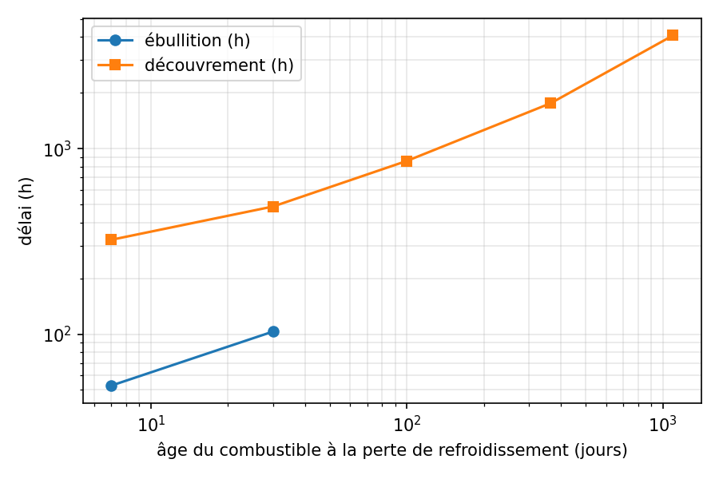
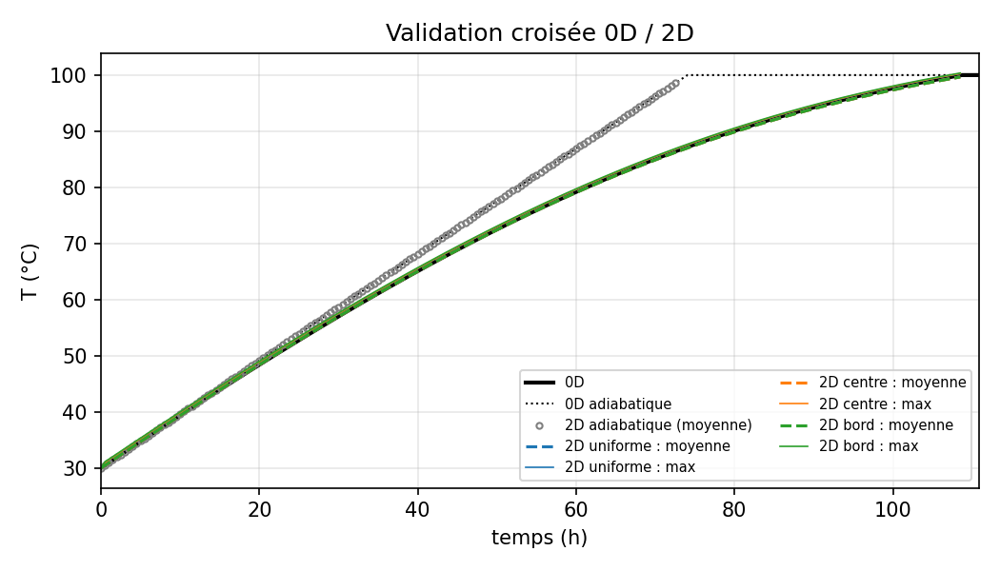

# Convection naturelle dans une piscine de combustible usé


**Question de sûreté.** Si le refroidissement d'une piscine d'entreposage de combustible usé s'arrête
(perte totale des alimentations électriques, cas de Fukushima Daiichi 4 en mars 2011), combien de temps
avant l'ébullition, puis avant que le haut des assemblages se découvre ? Et la convection naturelle
crée-t-elle des points chauds que le bilan global ne voit pas ?

**Démarche.** Trois modèles de finesse croissante, chacun vérifiant le suivant :

| Niveau | Modèle | Outil | État |
|---|---|---|---|
| 1 | 0D : piscine à température uniforme, puissance résiduelle, pertes en surface, ébullition | Python / scipy | ✅ |
| 2 | 2D : coupe verticale, Boussinesq, racks en milieu poreux chauffant | Python (solveur maison ψ–ω) | ✅ |
| 3 | 3D : géométrie Salome, CFD Code_Saturne k-ω SST, ParaView | Salome, Code_Saturne | ⏳ à faire (Linux / WSL) |

```bash
pip install -r requirements.txt
python scripts/niveau1_0d.py      # ~5 s  : courbes 0D, sensibilité, cas Fukushima 4
python scripts/niveau2_2d.py      # ~20 min : 2D, validation 0D/2D, points chauds, maillage, animation
python tests/test_modeles.py      # vérifications (ou : pytest)
```

---

## 1. Physique et hypothèses

**Puissance résiduelle** – loi de Way-Wigner, `P/P0 = 0,0622 [t^-0,2 − (t+T0)^-0,2]`.
Cas de référence : combustible représentant 1 GWth (≈ 1/3 de cœur d'un REP de 3 GWth) irradié 3 ans,
perte de refroidissement 30 jours après l'arrêt → **P(0) = 1,67 MW**.

**Bilan d'énergie 0D** – `m c dT/dt = P(t) − Φ_pertes(T)`, masse `m` suivie (évaporation), niveau
calculé avec ρ(T) (la dilatation fait monter le niveau d'environ 0,5 m avant l'ébullition).
À saturation, `dm/dt = −P/L` (toute la puissance vaporise : conservatif).

**Pertes en surface** – évaporation (corrélation ASHRAE/Carrier), convection naturelle air
(`h = 1,52 ΔT^1/3`), rayonnement (ε = 0,95) ; air du hall à 30 °C, HR 50 %, supposé constant.

**Piscine de référence** – 12 × 10 m, 12,5 m d'eau, 70 m³ de racks et d'assemblages,
sommet des assemblages à 4,5 m, eau à 30 °C → 1 424 t d'eau.

**Régime d'écoulement** – `Ra = gβΔTH³/(να) ≈ 8·10¹⁴` (ΔT = 10 K, H = 12,5 m) : très au-delà de
10⁹, l'écoulement est turbulent.

## 2. Niveau 1 – modèle 0D



| Cas de référence | Ébullition | Découvrement des assemblages |
|---|---|---|
| Adiabatique (conservatif) | **71 h** | 20,2 j |
| Avec pertes en surface | **103 h** | 20,3 j |

Contrôle de l'ordre de grandeur de l'énoncé : 1 500 m³ à 30 °C sous 2 MW constants → 60 h (test automatique).

Les pertes en surface retardent l'ébullition de 45 % : elles atteignent 0,56 MW à 80 °C et 1,2 MW
à 100 °C pour 120 m² ([figure](figures/0d_puissance_pertes.png)). En revanche elles n'influencent
presque pas le découvrement, gouverné par `P/L` une fois l'ébullition atteinte.

### Sensibilité (une variable à la fois)

| Paramètre | Valeur | P(0) | Ébullition | Découvrement |
|---|---|---|---|---|
| Âge du combustible | 7 j | 2,76 MW | 53 h | 13,4 j |
| | **30 j (réf.)** | 1,67 MW | 103 h | 20,3 j |
| | 100 j | 1,00 MW | jamais* | 35,8 j |
| | 1 an | 0,48 MW | jamais* | 73 j |
| | 3 ans | 0,20 MW | jamais* | 170 j |
| Niveau initial | 9,5 m | | 76 h | 12,8 j |
| | 11 m | | 90 h | 16,5 j |
| Température initiale | 25 → 50 °C | | 109 → 80 h | 20,6 → 19,1 j |

\* l'équilibre puissance / pertes s'établit sous 100 °C, mais l'évaporation continue de vider la piscine.
**Ce résultat repose entièrement sur la corrélation d'évaporation extrapolée** : à traiter comme optimiste.



**Ce qui compte vraiment :** l'âge du combustible domine (facteur 13 sur le délai de découvrement entre
7 jours et 3 ans), puis le niveau d'eau au-dessus des racks (−37 % de délai pour 3 m d'eau en moins).
La température initiale ne joue que sur le délai d'ébullition.

### Comparaison indicative : Fukushima Daiichi 4

Avec les valeurs couramment citées (piscine 12,2 × 9,9 m, ~11,5 m d'eau, ~2,26 MW, eau initiale ~27 °C),
le modèle donne ~100 °C à 61 h quand ~84 °C auraient été mesurés le 14 mars 2011.
**Ces données d'entrée sont à vérifier et citer précisément dans les rapports TEPCO, NRC et AIEA.**
Un modèle 0D trop pessimiste est cohérent avec une capacité thermique réelle plus grande : l'eau du puits
de cuve et de la piscine voisine, remplis pour les travaux en cours sur le réacteur 4, communiquait avec la
piscine (piste à confirmer dans les rapports).

## 3. Niveau 2 – convection naturelle 2D

**Modèle.** Coupe verticale 12 m × 12,5 m extrudée sur 10 m, maillage 48 × 50. Approximation de
Boussinesq (β = 5·10⁻⁴ K⁻¹), formulation fonction de courant / vorticité, Poisson résolu par
transformée en sinus. Racks : bloc poreux de 1 à 11 m et de 0,3 à 4,5 m, avec un frein de Darcy et une
source de chaleur volumique `P(t)`. Turbulence : viscosité effective constante ν_eff = α_eff = 5·10⁻³ m²/s.
Fond et côtés adhérents et adiabatiques, surface libre glissante avec le flux `flux_pertes(T)` du 0D.
Le schéma sur T est en volumes finis, avec des vitesses de face à divergence nulle par construction :
l'énergie est conservée à la précision machine.


**Structure de l'écoulement.** L'eau monte en panache au-dessus des racks, s'étale sous la surface,
redescend le long des parois puis repasse sous les racks. Avec des racks uniformes, on obtient deux
boucles symétriques. Si les assemblages chauds sont contre une paroi (cas « bord »), une seule boucle
occupe toute la piscine. Les vitesses atteignent 8 à 9 cm/s, et la boucle est établie en moins de
10 minutes (animation en tête de page).



| Vérification / résultat | Valeur |
|---|---|
| Adiabatique : écart T moyenne 2D / 0D sur 73 h | **< 0,001 K** (même énergie injectée) |
| Avec pertes : T moyenne 2D à l'instant d'ébullition 0D (108,6 h) | 99,7 °C (écart 0,3 K) |
| Surchauffe max (T_max − T_moy), racks uniformes / chauds au centre / chauds au bord | 0,55 / 0,61 / **0,70 K** |
| Surface libre plus froide que la moyenne | −0,2 K |
| Marge minimale à la saturation locale (pression hydrostatique incluse) | 0,7 K, atteinte **en surface** |
| Convergence de maillage, surchauffe à 6 h (24 / 48 / 96 mailles) | 0,57 / 0,63 / 0,64 K |
| Sensibilité à ν_eff (2,5 / 5 / 10 ·10⁻³ m²/s) : surchauffe ; v_max | 0,72 / 0,63 / 0,55 K ; 7,6 / 6,6 / 5,1 cm/s |

**Lecture physique.**
- Le brassage par convection naturelle est très efficace : à l'échelle de la piscine, l'hypothèse 0D
  d'une température uniforme tient à moins de 1 K près, même avec des assemblages chauds regroupés
  contre une paroi.
- Le point le plus chaud se trouve dans la moitié basse des racks, là où l'eau reste le plus longtemps
  au contact des assemblages ; dans le cas « bord », il est contre la paroi. Il dépasse 100 °C à la
  fin du calcul, mais à 10 m de profondeur la pression hydrostatique (≈ 1 bar de plus) relève la
  saturation locale vers 120 °C. **L'ébullition commence donc en surface, pas dans les racks.** On
  n'observe pas de panache chaud piégé sous la surface.
- L'écart de 0,3 K avec le 0D à l'ébullition vient de deux effets qui se compensent en partie. D'un côté,
  le 0D retire 78 t d'eau évaporée (5 % de la masse) et chauffe donc un peu plus vite. De l'autre, la
  surface du 2D est 0,2 K plus froide que la moyenne et perd donc un peu moins de chaleur. La
  comparaison strictement à l'identique est le cas adiabatique, où l'accord est parfait.
- Limite : ces chiffres sont à l'échelle de la maille (25 cm, plusieurs assemblages). L'écart
  gaine/eau à l'intérieur d'un assemblage n'est pas résolu, et l'intensité de la turbulence
  (ν_eff) déplace la surchauffe de ±15 %. Le niveau 3 (k-ω SST, géométrie 3D) doit confirmer ces valeurs.

## 4. Niveau 3 – simulation 3D (à faire)

Code_Saturne et Salome tournent sous Linux : sur Windows, utiliser WSL (`sudo apt install code-saturne`
sous Ubuntu 24.04) ou une VM. Réglages prévus :

- géométrie Salome : piscine 12 × 10 × 12,5 m, racks en bloc poreux, quelques centaines de milliers de mailles ;
- Boussinesq, turbulence k-ω SST (ou k-ε avec production par flottabilité) ;
- racks : milieu poreux (perte de charge des assemblages) + source de chaleur volumique `P(t)/V_racks` ;
- surface libre : paroi glissante avec le flux de pertes `flux_pertes(T)` de `piscine/physique.py` ;
- stationnaire d'abord, puis transitoire ; critère de validation : la température moyenne suit le 0D.

## 5. Limites et incertitudes (par ordre d'importance estimé)

1. **Puissance résiduelle réelle** – Way-Wigner n'est qu'un ordre de grandeur, d'autant moins fiable que
   le combustible est vieux, et ignore l'historique d'irradiation et le taux de combustion. À remplacer
   par ANS-5.1 ou un calcul d'évolution isotopique : c'est l'incertitude dominante, car tous les délais
   lui sont inversement proportionnels.
2. **Pertes en surface** – la corrélation d'évaporation est extrapolée de 30 °C à 100 °C ; elle décide
   à elle seule si les combustibles de plus de 100 jours atteignent l'ébullition. Négliger les pertes
   (cas adiabatique) donne le résultat conservatif.
3. **Turbulence** – le 2D utilise une viscosité effective constante : vitesses et surchauffes locales
   sont qualitatives. C'est l'objet du niveau 3.
4. **Racks en milieu poreux** – frein de Darcy linéaire non calibré sur les pertes de charge réelles.
5. Hors périmètre : ébullition locale sous-refroidie, découvrement partiel et oxydation des gaines,
   échauffement de l'air du hall, appoint d'eau.

## Organisation

```
piscine/physique.py   puissance résiduelle, propriétés de l'eau, pertes en surface
piscine/modele0d.py   niveau 1 (scipy solve_ivp, événements ébullition / découvrement)
piscine/modele2d.py   niveau 2 (ψ–ω + volumes finis conservatifs, Poisson par DST)
scripts/              génération des figures et des tableaux (figures/, resultats/)
tests/                vérifications : solutions analytiques, conservation de l'énergie, accord 0D/2D
```
