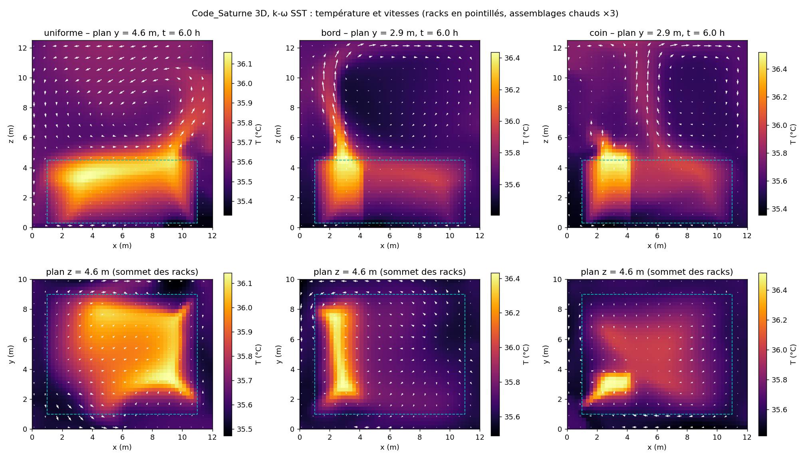
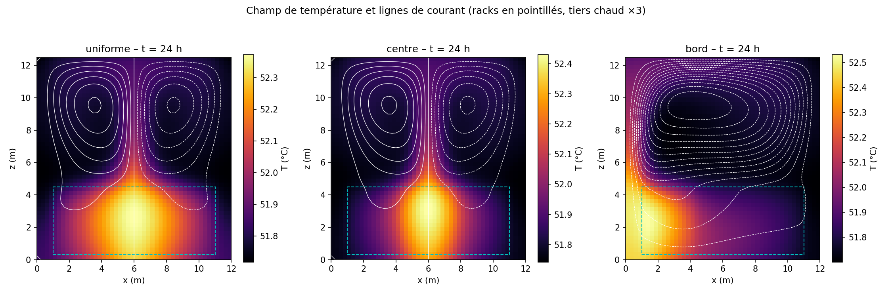
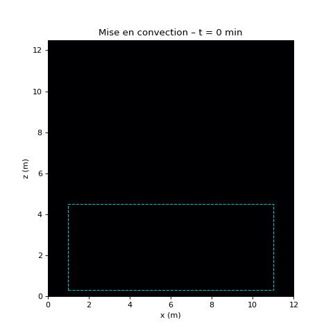
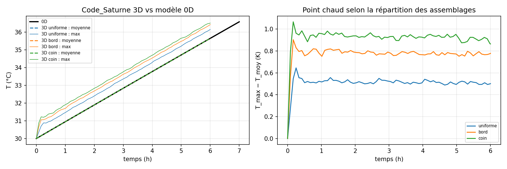

# Convection naturelle dans une piscine de combustible usé



**Question de sûreté.** Si le refroidissement d'une piscine d'entreposage de combustible usé s'arrête
(perte totale des alimentations électriques, cas de Fukushima Daiichi 4 en mars 2011), combien de temps
avant l'ébullition, puis avant que le haut des assemblages se découvre ? Et la convection naturelle
crée-t-elle des points chauds que le bilan global ne voit pas ?

**En bref** (piscine de référence : 1,67 MW de puissance résiduelle, 1 424 t d'eau à 30 °C) :
- **Ébullition** entre **71 h** (hypothèse adiabatique, conservative) et **103 h** (avec pertes en surface).
  **Découvrement** du haut des assemblages après environ **20 jours** sans appoint d'eau.
- Les modèles **0D, 2D et Code_Saturne 3D concordent à 0,001 K près** sur la température moyenne, et
  le bilan d'énergie de chaque calcul boucle à mieux que 0,01 %.
- La convection naturelle brasse efficacement la piscine. Le point chaud reste **inférieur à 0,9 K**
  au-dessus de la moyenne, même avec les assemblages chauds regroupés dans un coin. La pression
  hydrostatique laisse une marge d'environ 17 °C à la saturation au sommet des racks : **l'ébullition
  commence en surface**, et le modèle 0D suffit pour estimer les délais.
- Le paramètre dominant est **l'âge du combustible**, à travers la puissance résiduelle : le délai de
  découvrement est multiplié par 13 entre 7 jours et 3 ans de refroidissement.

**Démarche.** Trois modèles de finesse croissante, chacun vérifiant le suivant :

| Niveau | Modèle | Outil | État |
|---|---|---|---|
| 1 | 0D : piscine à température uniforme, puissance résiduelle, pertes en surface, ébullition | Python / scipy | ✅ |
| 2 | 2D : coupe verticale, Boussinesq, racks en milieu poreux chauffant | Python (solveur maison ψ–ω) | ✅ |
| 3 | 3D : CFD transitoire Boussinesq k-ω SST, racks poreux chauffants | Code_Saturne 9.0 (WSL), ParaView | ✅ |

```bash
pip install -r requirements.txt
python scripts/niveau1_0d.py      # ~5 s  : courbes 0D, sensibilité, cas Fukushima 4
python scripts/niveau2_2d.py      # ~20 min : 2D, validation 0D/2D, points chauds, maillage, animation
python tests/test_modeles.py      # vérifications (ou : pytest)
bash cfd3d/campagne.sh            # ~80 min, sous Linux/WSL : calculs Code_Saturne 3D (voir § 4)
python cfd3d/post_3d.py           # post-traitement 3D et comparaison au 0D
```

---

## 1. Physique et hypothèses

**Puissance résiduelle** – loi de Way-Wigner, `P/P0 = 0,0622 [t^-0,2 − (t+T0)^-0,2]`.
Cas de référence : combustible représentant 1 GWth (≈ 1/3 de cœur d'un REP de 3 GWth) irradié 3 ans,
perte de refroidissement 30 jours après l'arrêt → **P(0) = 1,67 MW**.

**Bilan d'énergie 0D** – `m c dT/dt = P(t) − Φ_pertes(T)`, masse `m` suivie (évaporation), niveau
calculé avec ρ(T) (la dilatation fait monter le niveau d'environ 0,5 m avant l'ébullition).
À saturation, `dm/dt = −P/L` (toute la puissance vaporise : conservatif).

**Pertes en surface** – évaporation (corrélation ASHRAE/Carrier), convection naturelle air
(`h = 1,52 ΔT^1/3`), rayonnement (ε = 0,95) ; air du hall à 30 °C, HR 50 %, supposé constant.

**Piscine de référence** – 12 × 10 m, 12,5 m d'eau, 70 m³ de racks et d'assemblages,
sommet des assemblages à 4,5 m, eau à 30 °C → 1 424 t d'eau.

**Régime d'écoulement** – `Ra = gβΔTH³/(να) ≈ 8·10¹⁴` (ΔT = 10 K, H = 12,5 m) : très au-delà de
10⁹, l'écoulement est turbulent.

## 2. Niveau 1 – modèle 0D


| Cas de référence | Ébullition | Découvrement des assemblages |
|---|---|---|
| Adiabatique (conservatif) | **71 h** | 20,2 j |
| Avec pertes en surface | **103 h** | 20,3 j |

Contrôle de l'ordre de grandeur de l'énoncé : 1 500 m³ à 30 °C sous 2 MW constants → 60 h (test automatique).

Les pertes en surface retardent l'ébullition de 45 % : elles atteignent 0,56 MW à 80 °C et 1,2 MW
à 100 °C pour 120 m² ([figure](figures/0d_puissance_pertes.png)). En revanche elles n'influencent
presque pas le découvrement, gouverné par `P/L` une fois l'ébullition atteinte.

### Sensibilité (une variable à la fois)

| Paramètre | Valeur | P(0) | Ébullition | Découvrement |
|---|---|---|---|---|
| Âge du combustible | 7 j | 2,76 MW | 53 h | 13,4 j |
| | **30 j (réf.)** | 1,67 MW | 103 h | 20,3 j |
| | 100 j | 1,00 MW | jamais* | 35,8 j |
| | 1 an | 0,48 MW | jamais* | 73 j |
| | 3 ans | 0,20 MW | jamais* | 170 j |
| Niveau initial | 9,5 m | | 76 h | 12,8 j |
| | 11 m | | 90 h | 16,5 j |
| Température initiale | 25 → 50 °C | | 109 → 80 h | 20,6 → 19,1 j |

\* l'équilibre puissance / pertes s'établit sous 100 °C, mais l'évaporation continue de vider la piscine.
**Ce résultat repose entièrement sur la corrélation d'évaporation extrapolée** : à traiter comme optimiste.


**Ce qui compte vraiment :** l'âge du combustible domine (facteur 13 sur le délai de découvrement entre
7 jours et 3 ans), puis le niveau d'eau au-dessus des racks (−37 % de délai pour 3 m d'eau en moins).
La température initiale ne joue que sur le délai d'ébullition.

### Comparaison indicative : Fukushima Daiichi 4

Avec les valeurs couramment citées (piscine 12,2 × 9,9 m, ~11,5 m d'eau, ~2,26 MW, eau initiale ~27 °C),
le modèle donne ~100 °C à 61 h quand ~84 °C auraient été mesurés le 14 mars 2011.
**Ces données d'entrée sont à vérifier et citer précisément dans les rapports TEPCO, NRC et AIEA.**
Un modèle 0D trop pessimiste est cohérent avec une capacité thermique réelle plus grande : l'eau du puits
de cuve et de la piscine voisine, remplis pour les travaux en cours sur le réacteur 4, communiquait avec la
piscine (piste à confirmer dans les rapports).

## 3. Niveau 2 – convection naturelle 2D

**Modèle.** Coupe verticale 12 m × 12,5 m extrudée sur 10 m, maillage 48 × 50. Approximation de
Boussinesq (β = 5·10⁻⁴ K⁻¹), formulation fonction de courant / vorticité, Poisson résolu par
transformée en sinus. Racks : bloc poreux de 1 à 11 m et de 0,3 à 4,5 m, avec un frein de Darcy et une
source de chaleur volumique `P(t)`. Turbulence : viscosité effective constante ν_eff = α_eff = 5·10⁻³ m²/s.
Fond et côtés adhérents et adiabatiques, surface libre glissante avec le flux `flux_pertes(T)` du 0D.
Le schéma sur T est en volumes finis, avec des vitesses de face à divergence nulle par construction :
l'énergie est conservée à la précision machine.



**Structure de l'écoulement.** L'eau monte en panache au-dessus des racks, s'étale sous la surface,
redescend le long des parois puis repasse sous les racks. Avec des racks uniformes, on obtient deux
boucles symétriques. Si les assemblages chauds sont contre une paroi (cas « bord »), une seule boucle
occupe toute la piscine. Les vitesses atteignent 8 à 9 cm/s, et la boucle est établie en moins de
10 minutes :




| Vérification / résultat | Valeur |
|---|---|
| Adiabatique : écart T moyenne 2D / 0D sur 73 h | **< 0,001 K** (même énergie injectée) |
| Avec pertes : T moyenne 2D à l'instant d'ébullition 0D (108,6 h) | 99,7 °C (écart 0,3 K) |
| Surchauffe max (T_max − T_moy), racks uniformes / chauds au centre / chauds au bord | 0,55 / 0,61 / **0,70 K** |
| Surface libre plus froide que la moyenne | −0,2 K |
| Marge minimale à la saturation locale (pression hydrostatique incluse) | 0,7 K, atteinte **en surface** |
| Convergence de maillage, surchauffe à 6 h (24 / 48 / 96 mailles) | 0,57 / 0,63 / 0,64 K |
| Sensibilité à ν_eff (2,5 / 5 / 10 ·10⁻³ m²/s) : surchauffe ; v_max | 0,72 / 0,63 / 0,55 K ; 7,6 / 6,6 / 5,1 cm/s |

**Lecture physique.**
- Le brassage par convection naturelle est très efficace : à l'échelle de la piscine, l'hypothèse 0D
  d'une température uniforme tient à moins de 1 K près, même avec des assemblages chauds regroupés
  contre une paroi.
- Le point le plus chaud se trouve dans la moitié basse des racks, là où l'eau reste le plus longtemps
  au contact des assemblages ; dans le cas « bord », il est contre la paroi. Il dépasse 100 °C à la
  fin du calcul, mais à 10 m de profondeur la pression hydrostatique (≈ 1 bar de plus) relève la
  saturation locale vers 120 °C. **L'ébullition commence donc en surface, pas dans les racks.** On
  n'observe pas de panache chaud piégé sous la surface.
- L'écart de 0,3 K avec le 0D à l'ébullition vient de deux effets qui se compensent en partie. D'un côté,
  le 0D retire 78 t d'eau évaporée (5 % de la masse) et chauffe donc un peu plus vite. De l'autre, la
  surface du 2D est 0,2 K plus froide que la moyenne et perd donc un peu moins de chaleur. La
  comparaison strictement à l'identique est le cas adiabatique, où l'accord est parfait.
- Limite : ces chiffres sont à l'échelle de la maille (25 cm, plusieurs assemblages). L'écart
  gaine/eau à l'intérieur d'un assemblage n'est pas résolu, et l'intensité de la turbulence
  (ν_eff) déplace la surchauffe de ±15 %. Le niveau 3 (k-ω SST, 3D) retrouve le même ordre de grandeur.

## 4. Niveau 3 – simulation 3D Code_Saturne

**Modèle** ([cfd3d/SRC/cs_user_piscine.cpp](cfd3d/SRC/cs_user_piscine.cpp)) – Code_Saturne 9.0.2 (EDF),
volumes finis, transitoire à pas adaptatif (Courant ≤ 4) :

- **maillage** : piscine 12 × 10 × 12,5 m, maillage cartésien interne de 48 × 40 × 50 (96 000 mailles, pas de
  25 cm). La géométrie est une boîte, donc Salome n'est pas nécessaire ;
- **Boussinesq** (`idilat = 0`) avec un coefficient de dilatation **β(T) sécant**, défini pour que la
  flottabilité vaille exactement ρ(30 °C) − ρ(T) du fit utilisé en 0D. Ce β sécant passe ainsi de 3,2·10⁻⁴ à
  5,3·10⁻⁴ K⁻¹ entre 30 et 100 °C. Viscosité μ(T) par la loi de Vogel ;
- **turbulence k-ω SST**, avec production et dissipation par flottabilité ;
- **racks** : bloc poreux (frein linéaire implicite σ = 0,2 s⁻¹) et puissance de Way-Wigner répartie en
  volume. Les assemblages « chauds » ont une puissance ×3 : tiers des racks contre la paroi x = 0 (« bord »)
  ou neuvième situé dans le coin x, y = 0 (« coin ») ;
- **surface libre** : symétrie (glissement), avec le flux `flux_pertes(T)` du 0D imposé face par face.
  Fond et parois : paroi lisse adiabatique.

```bash
# sous WSL / Linux, Code_Saturne compilé dans ~/cs/arch (voir plus bas)
bash cfd3d/campagne.sh          # 3 répartitions × 6 h + maillages 32 et 64 : ~80 min sur 4 cœurs
python cfd3d/post_3d.py         # depuis Windows ou Linux : figures/3d_*.png et tableaux
```




| Vérification / résultat (6 h de transitoire) | uniforme | bord | coin |
|---|---|---|---|
| Écart max T moyenne 3D / 0D | 0,001 K | 0,001 K | 0,001 K |
| Bilan d'énergie : ΔE / ∫(P − pertes)dt − 1 | < 0,01 % | 0,01 % | < 0,01 % |
| **Surchauffe T_max − T_moy** (établie après ~20 min) | **0,50 K** | **0,78 K** | **0,86 K** |
| Position du point chaud (x, y, z) | (3,6 ; 4,6 ; 3,4) m | (2,9 ; 2,9 ; 4,4) m | (2,9 ; 2,9 ; 4,4) m |
| T surface − T moyenne | −0,03 K | +0,02 K | +0,07 K |
| Vitesse max | 7,4 cm/s | 9,9 cm/s | 10,3 cm/s |

| Convergence de maillage (uniforme, moyenne sur 1–2 h) | 32 × 27 × 33 | 48 × 40 × 50 | 64 × 53 × 67 |
|---|---|---|---|
| Mailles | 28 512 | 96 000 | 227 264 |
| Surchauffe | 0,50 K | 0,53 K | 0,51 K |
| Vitesse max | 8,3 cm/s | 8,5 cm/s | 8,2 cm/s |

La surchauffe varie de moins de 5 % entre 28 000 et 227 000 mailles. Le maillage de 96 000 mailles suffit.

**Ce que la 3D apporte par rapport au 0D et au 2D :**
- **Brisure de symétrie.** Avec des racks uniformes, le 2D donne deux boucles symétriques. En 3D, cet état
  est instable : un panache unique se décolle vers un côté et entraîne une grande boucle dans toute la
  piscine. Ce comportement est typique d'un panache turbulent confiné.
- **Le point chaud est en sortie de racks quand les assemblages chauds sont regroupés.** Au-dessus d'eux,
  l'eau traverse les racks de bas en haut et se réchauffe sur toute leur hauteur : le maximum se trouve à leur
  sommet (z = 4,4 m). Avec des racks uniformes, il reste à l'intérieur (z = 3,4 m), sous le pied du panache.
  Le 2D le plaçait plus bas, probablement parce qu'une coupe empêche l'eau froide d'arriver par les côtés.
- **L'asymétrie compte, mais peu.** Regrouper les assemblages chauds dans un coin fait passer la surchauffe
  de 0,50 à 0,86 K. C'est le cas le plus pénalisant, mais il reste négligeable face à la marge à la saturation
  locale : environ 117 °C au sommet des racks, sous 8 m d'eau.
- **Pas de couche chaude piégée sous la surface.** La surface reste à ±0,07 K de la moyenne : le panache
  arrive à la surface et y cède ses pertes. **Le 0D est donc le bon modèle pour les délais d'ébullition**,
  et la 3D confirme qu'aucune ébullition locale ne précède l'ébullition globale.

**Installation de Code_Saturne sous WSL (Ubuntu 24.04 ne fournit plus de paquet).** Installer d'abord les
dépendances en root, puis compiler la version LTS :

```bash
sudo apt install build-essential gfortran autoconf automake libtool pkg-config bison flex \
  python3-dev libopenmpi-dev openmpi-bin zlib1g-dev libxml2-dev python3-pyqt5 pyqt5-dev-tools
git clone --depth 1 --branch v9.0.2 https://github.com/code-saturne/code_saturne.git ~/cs/src
cd ~/cs/src && ./sbin/bootstrap && mkdir ../build && cd ../build
../src/configure --prefix=$HOME/cs/arch CC=mpicc CXX=mpicxx FC=gfortran && make -j8 && make install
```

**Visualisation ParaView.** Ouvrir `~/cs/etudes/piscine/CAS_<cas>_nx48/RESU/<date>/postprocessing/RESULTS.case`
(depuis Windows : `\\wsl.localhost\Ubuntu\home\<user>\cs\...`). Une sortie est écrite toutes les 30 min ;
utiliser les filtres *Slice*, *Stream Tracer* et *Glyph*.

## 5. Limites et incertitudes (par ordre d'importance estimé)

1. **Puissance résiduelle réelle** – Way-Wigner n'est qu'un ordre de grandeur, d'autant moins fiable que
   le combustible est vieux, et ignore l'historique d'irradiation et le taux de combustion. À remplacer
   par ANS-5.1 ou un calcul d'évolution isotopique : c'est l'incertitude dominante, car tous les délais
   lui sont inversement proportionnels.
2. **Pertes en surface** – la corrélation d'évaporation est extrapolée de 30 °C à 100 °C ; elle décide
   à elle seule si les combustibles de plus de 100 jours atteignent l'ébullition. Négliger les pertes
   (cas adiabatique) donne le résultat conservatif.
3. **Turbulence** – le 2D (viscosité effective constante) et la 3D (k-ω SST) donnent des surchauffes du même
   ordre (0,5 à 0,9 K) ; les vitesses restent à confirmer sur des mesures. Le k-ω SST n'est pas validé
   spécifiquement pour les panaches thermiques confinés.
4. **Racks en milieu poreux** – frein de Darcy linéaire non calibré sur les pertes de charge réelles des
   assemblages. La surchauffe est moyennée sur 25 cm : l'écart gaine/eau dans un sous-canal n'est pas résolu.
5. **Durée de la 3D** – 6 h de transitoire (30 → 36 °C). La surchauffe est établie dès 20 min et stable ensuite,
   mais le régime proche de 100 °C, où les pertes en surface dominent, n'a pas été simulé (environ 10 h de
   calcul par cas).
6. Hors périmètre : ébullition locale sous-refroidie, découvrement partiel et oxydation des gaines,
   échauffement de l'air du hall, appoint d'eau.

## Organisation

```
piscine/physique.py   puissance résiduelle, propriétés de l'eau, pertes en surface
piscine/modele0d.py   niveau 1 (scipy solve_ivp, événements ébullition / découvrement)
piscine/modele2d.py   niveau 2 (ψ–ω + volumes finis conservatifs, Poisson par DST)
scripts/              génération des figures et des tableaux (figures/, resultats/)
cfd3d/SRC/            niveau 3 : fonctions utilisateur Code_Saturne (maillage, physique, CL, sorties)
cfd3d/lancer.sh       crée et lance un cas ; campagne.sh enchaîne la campagne ; post_3d.py la dépouille
cfd3d/resultats/      séries temporelles et logs des calculs 3D (instantanés CSV non versionnés)
tests/                vérifications : solutions analytiques, conservation de l'énergie, accord 0D/2D
```
